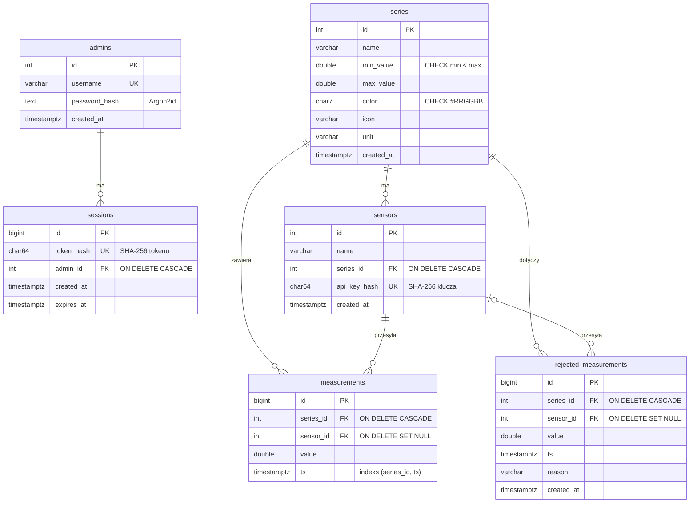

# Diagram ERD

## Opis tabel

- `admins` – konta administratorów; hasło tylko jako skrót Argon2id.
- `sessions` – ważne tokeny Bearer (1 h); w bazie wyłącznie skrót SHA-256 tokenu.
- `series` – konfiguracja serii: nazwa, przedział `min_value`..`max_value` (ograniczenie `CHECK min < max`), kolor, znacznik, jednostka.
- `sensors` – czujnik przypisany do jednej serii; klucz API tylko jako skrót SHA-256. Usunięcie serii usuwa jej czujniki.
- `measurements` – wyniki. Usunięcie serii usuwa wyniki (`CASCADE`); wyrejestrowanie czujnika zostawia je (`sensor_id = NULL`). Indeks `(series_id, ts)` przyspiesza zapytania po serii i czasie.
- `rejected_measurements` – log odrzuconych wyników (wartość spoza przedziału, czas z przyszłości), wyświetlany w panelu administratora.
